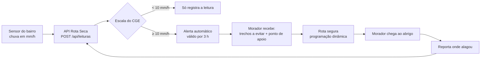
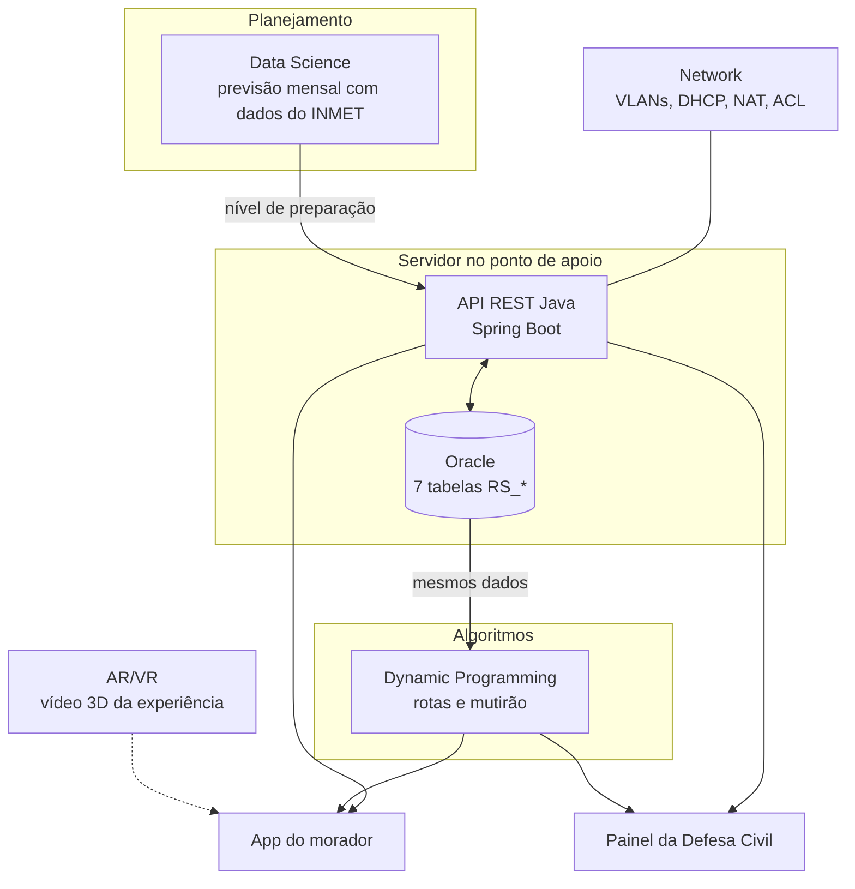
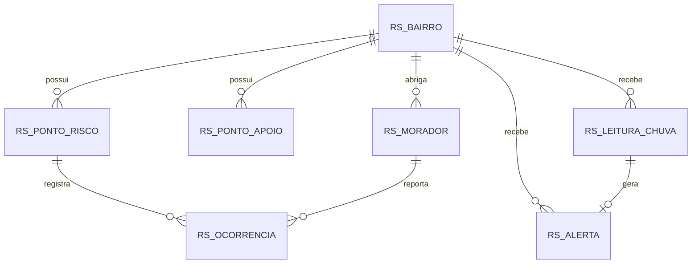

<div align="center">

# 🌧️ Rota Seca

**Avisa antes. Guia com segurança.**

Alerta de chuva forte por bairro e a rota mais segura até um ponto de apoio, para quem mora em área de alagamento na várzea do Rio Tietê, Zona Leste de São Paulo.


CitizenTech da **Global Solution FIAP 2026.2** · Engenharia de Software · 2º ano

[API no ar](https://rota-seca-api-l3hb.onrender.com) · [Swagger](https://rota-seca-api-l3hb.onrender.com/swagger-ui.html) · [Vídeo 3D](https://youtu.be/u51s8odtH1M) · [Pitch](https://youtu.be/QFMzP6bC7pI)

</div>

---

## Sumário

1. [O problema](#1-o-problema)
2. [A solução](#2-a-solução)
3. [Arquitetura da solução](#3-arquitetura-da-solução)
4. [Estrutura do repositório](#4-estrutura-do-repositório)
5. [Módulos e técnicas](#5-módulos-e-técnicas)
   - [5.1 API REST (Domain Driven Design – Java)](#51-api-rest-domain-driven-design--java)
   - [5.2 Banco de dados (Database Design)](#52-banco-de-dados-database-design)
   - [5.3 Rotas seguras (Dynamic Programming)](#53-rotas-seguras-dynamic-programming)
   - [5.4 Previsão de chuva extrema (Data Science)](#54-previsão-de-chuva-extrema-data-science)
   - [5.5 Rede do ponto de apoio (Network)](#55-rede-do-ponto-de-apoio-network)
   - [5.6 Vídeo 3D (AR/VR)](#56-vídeo-3d-arvr)
   - [5.7 Design da solução (Agile)](#57-design-da-solução-agile)
6. [Como executar](#6-como-executar)
7. [Testes](#7-testes)
8. [Resultados em números](#8-resultados-em-números)
9. [ODS e indicadores de impacto](#9-ods-e-indicadores-de-impacto)
10. [Limitações](#10-limitações)
11. [Uso de IA](#11-uso-de-ia)
12. [Dados e privacidade](#12-dados-e-privacidade)
13. [Equipe](#13-equipe)
14. [Referências](#14-referências)

---

## 1. O problema

O **Jardim Pantanal**, no distrito do Jardim Helena, cresceu sobre a várzea do Rio Tietê e convive com alagamentos há cerca de três décadas. São cerca de **45 mil moradores**. Em fevereiro de 2025, moradores ficaram ilhados por cerca de seis dias; em setembro de 2026, o bairro voltou a alagar por vários dias seguidos.

Nessas horas, o morador depende de olhar o céu, de grupos de mensagem ou de avisos genéricos para a cidade inteira, que não dizem o que mais importa: **se a rua dele vai alagar, qual caminho ainda está seco e para onde ir.**

> **Problema, em uma frase:** moradores de áreas que alagam não sabem a tempo quando a chuva vai ser forte nem qual caminho é seguro para sair ou voltar para casa.

**Quem mais sofre:** idosos, pessoas com mobilidade reduzida e trabalhadores que voltam para casa a pé ou de transporte público, porque precisam de mais tempo para sair e têm menos alternativas.

| Público | O que precisa |
|---|---|
| **Primário:** moradores das áreas de risco | Aviso por bairro, linguagem simples e um caminho seguro até um ponto de apoio, mesmo em celulares simples |
| **Secundário:** agentes da Defesa Civil | Visão única do que está em alerta, do que está alagado e de onde há vagas |
| **Terciário:** coordenação de prevenção | Planejar limpeza de bueiros e preparação dos abrigos antes da chuva, com recursos limitados |

## 2. A solução

A Rota Seca é formada por uma **API** que concentra as regras de negócio, um **app para o morador** e um **painel para a Defesa Civil** (protótipos de tela), além de algoritmos de rota, um modelo de previsão e a rede que sustenta o servidor no ponto de apoio.



1. **Leitura de chuva:** o serviço de medição envia a chuva de cada bairro em mm/h.
2. **Classificação:** a leitura é classificada pela escala do CGE-SP: abaixo de 10 mm/h **baixo**, a partir de 10 **moderado**, a partir de 25 **alto** e a partir de 50 **muito alto**.
3. **Alerta automático:** a partir de chuva moderada, o sistema gera um alerta para o bairro, válido por 3 horas, dizendo quais trechos evitar e qual ponto de apoio procurar.
4. **Rota segura:** o caminho até o ponto de apoio ativo mais próximo desvia dos trechos com água acima do limite: **30 cm** para o público geral e **10 cm** para idosos (60+) e pessoas com mobilidade reduzida.
5. **Reporte:** o morador informa onde alagou e até onde a água chegou, o que atualiza o histórico do ponto de risco.
6. **Prevenção:** a coordenação usa a previsão mensal de chuva extrema e o plano de mutirão para se preparar antes da temporada.

**Diferenciais:** o aviso é por bairro, e não para a cidade inteira; diz **para onde ir e por onde**; prioriza quem tem mais dificuldade para sair; e o próprio morador ajuda a manter o mapa de riscos atualizado.

## 3. Arquitetura da solução

Cada disciplina constrói uma parte da mesma solução, usando os **mesmos dados** (bairros, pontos de risco, pontos de apoio, moradores e leituras de chuva).



| Parte | O que faz na Rota Seca |
|---|---|
| **Domain Driven Design (Java)** | API REST publicada no Render: bairros, pontos de risco e de apoio, leituras, alertas automáticos, moradores e ocorrências |
| **Database Design** | Modelo relacional no Oracle, com as mesmas 7 tabelas usadas pela API |
| **Dynamic Programming** | Rota segura com memoização, tempos até os pontos de apoio com Floyd-Warshall e plano de mutirão com mochila 0/1 |
| **Data Science** | Previsão mensal de chuva extrema com regressão linear e logística |
| **Network** | Rede do ponto de apoio que hospeda o servidor e oferece Wi-Fi ao público |
| **AR/VR** | Vídeo 3D da rua alagada e do trajeto seguro |
| **Agile** | Ideia, personas, casos de uso, backlog, protótipo e pitch |

## 4. Estrutura do repositório

```
rota-seca/
├── ddd-java/                          # API REST Spring Boot + Oracle
│   ├── src/main/java/br/com/fiap/rotaseca/
│   │   ├── model/                     # entidades de domínio e enums
│   │   ├── dao/                       # SQL com JdbcTemplate
│   │   ├── bo/                        # regras de negócio
│   │   ├── controller/                # endpoints REST
│   │   ├── exception/                 # exceções e GlobalExceptionHandler
│   │   └── config/                    # Swagger e CORS
│   ├── src/main/resources/db/         # schema.sql, data.sql, drop.sql
│   ├── src/test/                      # testes de ponta a ponta (MockMvc + H2)
│   ├── docs/                          # documentação em HTML e PDF
│   ├── Dockerfile
│   └── pom.xml
├── GS2026_DatabaseDesign_RotaSeca/    # DDL, DML, DQL e documento do modelo
├── Dynamic/                           # rotas seguras e mutirão (Python puro)
│   ├── main.py  dados.py  grafo.py  rotas.py  mutirao.py  eficiencia.py
│   └── testes/
├── GS2026_DataScience_RotaSeca/       # notebook, base do INMET e fonte dos dados
├── NETWORK_RotaSeca_Equipe10/         # projeto Packet Tracer (.pkt) e documento
├── RotaSeca_ARVR.pdf                  # documento do vídeo 3D
├── RotaSeca_Agile.pdf                 # design da solução, backlog e pitch
├── prompts.md                         # registro do uso de IA
└── README.md
```

## 5. Módulos e técnicas

### 5.1 API REST (Domain Driven Design – Java)

📁 [`ddd-java/`](ddd-java/) · 🌐 [API](https://rota-seca-api-l3hb.onrender.com) · 📖 [Swagger](https://rota-seca-api-l3hb.onrender.com/swagger-ui.html)

| Ferramenta | Versão |
|---|---|
| Java (JDK) | 21 |
| Spring Boot | 3.5.6 |
| Maven | 3.9+ |
| Banco | Oracle 19c (`oracle.fiap.com.br`), driver ojdbc11 |
| Banco local de desenvolvimento | H2 em memória (perfil `dev`) |
| Deploy | Render.com com Docker |

**Arquitetura em camadas:** `controller` → `bo` → `dao` → Oracle, mais `exception` para os erros e `config` para Swagger e CORS.

**Técnicas e regras de negócio**

- **Alerta automático na mesma transação:** ao registrar uma leitura (`POST /api/leituras`), o BO classifica a chuva e, a partir de moderada, gera o alerta para o bairro com os dois pontos de risco mais graves a evitar e o ponto de apoio ativo de maior capacidade. Leitura e alerta são gravados com `@Transactional`: ou os dois, ou nenhum.
- **Público prioritário:** `GET /api/moradores/{id}/alertas` devolve os alertas em vigor no bairro do morador e marca idosos (60+) e pessoas com mobilidade reduzida como `prioritario: true`. Em chuva muito alta, a mensagem orienta essas pessoas a sair imediatamente.
- **A ocorrência ensina o ponto de risco:** se um morador reporta uma lâmina d'água maior que a máxima conhecida, o ponto de risco é atualizado.
- **Ciclo da ocorrência:** `ABERTA → EM_ATENDIMENTO → ENCERRADA`. Uma ocorrência encerrada não pode ser reaberta.
- **Integridade:** telefone de morador único, bairro único por cidade, validade do alerta posterior à emissão, leituras e ocorrências não podem estar no futuro e um bairro com dados ligados não pode ser excluído.
- **Tratamento global de erros** com `@RestControllerAdvice`, sempre no mesmo formato:

```json
{ "timestamp": "2026-11-16T18:30:00", "status": 422, "erro": "Unprocessable Entity",
  "mensagem": "O bairro 99 não existe", "caminho": "/api/pontos-apoio" }
```

| Status | Quando |
|---|---|
| 400 | Campos inválidos, JSON malformado, enum ou data inválidos |
| 404 | Registro ou endpoint não encontrado |
| 409 | Registro duplicado ou ainda referenciado |
| 422 | Regra de negócio violada |
| 503 / 500 | Falha no banco / erro inesperado |

**Endpoints (37 no total)**

| Recurso | Endpoints |
|---|---|
| Bairros | `GET /api/bairros` · `GET/PUT/DELETE /api/bairros/{id}` · `POST /api/bairros` |
| Pontos de risco | `GET /api/pontos-risco?bairroId=` · `GET/PUT/DELETE /api/pontos-risco/{id}` · `POST /api/pontos-risco` |
| Pontos de apoio | `GET /api/pontos-apoio?bairroId=` (com bairro: só ativos, por capacidade) · `GET/PUT/DELETE /api/pontos-apoio/{id}` · `POST /api/pontos-apoio` |
| Leituras de chuva | `GET /api/leituras?bairroId=` · `GET/PUT/DELETE /api/leituras/{id}` · `POST /api/leituras` (gera alerta) |
| Alertas | `GET /api/alertas` · `GET /api/alertas/ativos?bairroId=` · `GET/PUT/DELETE /api/alertas/{id}` · `POST /api/alertas` (manual) |
| Moradores | `GET /api/moradores` · `GET/PUT/DELETE /api/moradores/{id}` · `GET /api/moradores/{id}/alertas` · `POST /api/moradores` |
| Ocorrências | `GET /api/ocorrencias?status=` · `GET/PUT/DELETE /api/ocorrencias/{id}` · `POST /api/ocorrencias` |

**Exemplo:** registrar uma chuva forte e receber o alerta gerado.

```http
POST /api/leituras
Content-Type: application/json

{ "bairroId": 1, "precipitacaoMm": 55.0, "umidade": 97, "fonte": "Sensor simulado" }
```

A resposta (`201 Created`) traz a leitura salva, o `nivelRisco` calculado e o `alertaGerado`, ou `null` quando a chuva é fraca.

Detalhes completos em [`ddd-java/README.md`](ddd-java/README.md).

### 5.2 Banco de dados (Database Design)

📁 [`GS2026_DatabaseDesign_RotaSeca/`](GS2026_DatabaseDesign_RotaSeca/)

Modelo relacional no **Oracle** com 7 tabelas, as mesmas usadas pela API:



| Script | Conteúdo |
|---|---|
| `01_DDL_RotaSeca.sql` | `CREATE TABLE`, chaves primárias e estrangeiras, constraints e `COMMENT ON` em tabelas e colunas |
| `02_DML_RotaSeca.sql` | Dados de exemplo (simulados) |
| `03_DQL_RotaSeca.sql` | Três consultas de apoio à decisão |
| `RotaSeca_DatabaseDesign.pdf` | Documento do modelo |

**Consultas (DQL)**

1. **Ocorrências em aberto por gravidade:** `INNER JOIN` entre ocorrência e ponto de risco, ordenado de `MUITO_ALTO` para `BAIXO` com `CASE`.
2. **Chuva por bairro:** quantidade de leituras, maior chuva e média com `COUNT`, `MAX`, `AVG` e `GROUP BY`.
3. **Bairros populosos sem ponto de apoio ativo:** `LEFT OUTER JOIN` para encontrar bairros com 30 mil habitantes ou mais que ficariam sem atendimento.

Ordem de execução: `01_DDL` → `02_DML` → `03_DQL`.

### 5.3 Rotas seguras (Dynamic Programming)

📁 [`Dynamic/`](Dynamic/) · Python 3.10+, sem bibliotecas externas

**Modelagem:** o bairro vira um **grafo ponderado** com **21 locais** (casas, esquinas, pontos de risco e pontos de apoio) e **28 trechos de rua**.

- **Lâmina d'água estimada** em um trecho com ponto de risco: `lâmina = lâmina máxima registrada × min(1, chuva mm/h ÷ 50)`
- **Bloqueio:** o trecho sai do grafo se a lâmina passar de 30 cm (geral) ou 10 cm (prioritário).
- **Custo de um trecho:** `metros × (1 + lâmina ÷ 10)`. Um trecho seco custa o próprio comprimento; com água, fica mais caro.
- **Velocidade a pé:** 80 m/min (geral) e 40 m/min (prioritário).

| Funcionalidade | Técnica | Complexidade |
|---|---|---|
| Rota do morador até o ponto de apoio mais próximo | **Memoização** sobre o grafo | O(V·E) tempo, O(V²) memória |
| Tempo de todos os locais para todos os locais | **Tabulação com Floyd-Warshall** | O(V³) tempo, O(V²) memória |
| Plano de mutirão com horas de equipe limitadas | **Tabulação com mochila 0/1** | O(n·H), contra O(2ⁿ) da força bruta |

**Memoização.** `custo(v, k)` é o menor custo para sair de `v` e chegar a qualquer ponto de apoio ativo usando no máximo `k` trechos:

```
custo(v, k) = 0                                    se v é ponto de apoio ativo
custo(v, 0) = ∞                                    se v não é ponto de apoio
custo(v, k) = min( custo(v, k−1),
                   min sobre os vizinhos u: trecho(v,u) + custo(u, k−1) )
```

**Floyd-Warshall.** `dist[i][j] = min(dist[i][j], dist[i][k] + dist[k][j])`, com uma segunda tabela `proximo[i][j]` para reconstruir qualquer rota.

**Mochila 0/1.** Cada tarefa consome horas e vale `pessoas × peso do nível de risco` (BAIXO 1, MODERADO 2, ALTO 3, MUITO_ALTO 4):

```
tabela[i][h] = max( tabela[i−1][h], tabela[i−1][h − horas_i] + valor_i )
```

**Validação:** o algoritmo de **Dijkstra** serve de referência independente; memoização e Floyd-Warshall precisam dar o mesmo custo em todos os cenários de chuva e para os dois perfis. A mochila é comparada com a força bruta para orçamentos de 0 a 69 horas.

**Resultados com chuva de 62,4 mm/h (muito alto)**

| Morador | Perfil | Destino | Distância | Tempo | Desvio |
|---|---|---|---|---|---|
| Maria Aparecida | prioritário | Abrigo Comunitário Pantanal | 380 m | 10 min | +150 m, evita a rua do córrego |
| José Carlos | geral | Escola Municipal do Bairro | 300 m | 4 min | +160 m, evita a travessa da escola |
| Ana Beatriz | geral | UBS Jardim Romano | 360 m | 4 min | +240 m, evita o ponto de ônibus |
| Antônio Ferreira | prioritário | Centro Comunitário Vila Itaim | 350 m | 9 min | +190 m, evita a viela da várzea |
| Lucas Souza | geral | Centro Comunitário Vila Itaim | 650 m | 8 min | atravessa a ponte com 10 cm, dentro do limite geral |

**Mutirão com 40 horas:** 5 tarefas escolhidas (39 h), protegendo **1.340 pessoas**.

**Eficiência da memoização (rota da Maria)**

| k (máx. de trechos) | Chamadas sem memoização | Chamadas com memoização |
|---|---|---|
| 4 | 95 | 42 |
| 6 | 1.099 | 101 |
| 8 | 13.225 | 183 |
| 10 | 161.069 | 269 |

Detalhes completos em [`Dynamic/README.md`](Dynamic/README.md).

### 5.4 Previsão de chuva extrema (Data Science)

📁 [`GS2026_DataScience_RotaSeca/`](GS2026_DataScience_RotaSeca/) · Python, pandas, NumPy, matplotlib, seaborn, scikit-learn

É a **camada de planejamento** da Rota Seca: com um mês de antecedência, indica onde é mais provável um dia com **50 mm ou mais** de chuva (aviso laranja, "Perigo", do INMET), para preparar mutirões e abrigos.

**Dados:** estações automáticas do **INMET**, consolidadas por mês (2020 a out/2026). O notebook usa as **43 estações do estado de São Paulo** (3.314 meses-estação).

**Perguntas e modelos**

| Pergunta | Modelo | Resultado no teste |
|---|---|---|
| Quanto vai chover no próximo mês? | **Regressão linear** | R² 0,44 · MAE 54,1 mm · RMSE 73,3 mm (≈30% menos erro que a média simples) |
| Haverá um dia com ≥ 50 mm no próximo mês? | **Regressão logística** | Recall 74,5% · F1 0,55 · ROC AUC 0,78 (3 de cada 4 meses perigosos identificados) |

**Técnicas**

- **Divisão temporal**, sem vazamento: treino com meses previstos de fev/2020 a dez/2024 e teste de jan/2025 a out/2026.
- **Variáveis do mês t para prever o mês t+1**, com reindexação mensal por estação antes do `shift(-1)`.
- **Pipeline** (`SimpleImputer` com mediana → `StandardScaler` → modelo), ajustado só no treino.
- **Codificação cíclica do mês** (`mes_sin`, `mes_cos`), para dezembro e janeiro ficarem próximos.
- **Tratamento de outliers de sensor** (radiação acima de 40 ou igual a 0 MJ/m² vira ausente).
- **Classes desbalanceadas** com `class_weight='balanced'`, priorizando o recall: deixar de avisar é pior do que preparar à toa.
- **Linhas de base** (média geral e climatologia) para provar que o modelo agrega valor.
- Análise exploratória feita **somente no treino**.

**Do modelo para a ação:** a probabilidade vira um nível de preparação.

| Probabilidade | Nível | O que a Rota Seca faz |
|---|---|---|
| < 0,40 | 🟢 Rotina | Monitoramento normal dos avisos oficiais |
| 0,40 a 0,65 | 🟡 Atenção | Revisar pontos de apoio e rotas; campanha de cadastro |
| ≥ 0,65 | 🟠 Preparação | Mutirão de zeladoria e pré-ativação de alertas e rotas |

**Estimativa para novembro de 2026:** cerca de 204 mm no Mirante de Santana e 220 mm em Interlagos (64% e 78% acima da média de novembro de 2020 a 2025), com probabilidade de 0,73 e 0,75 de um dia com 50 mm ou mais. As duas estações da capital ficam em 🟠 Preparação, assim como 19 das 23 estações com dados completos.

> É uma estimativa do modelo, não uma previsão oficial.

### 5.5 Rede do ponto de apoio (Network)

📁 [`NETWORK_RotaSeca_Equipe10/`](NETWORK_RotaSeca_Equipe10/) · Cisco Packet Tracer

A rede de uma escola pública que, em dias de chuva forte, vira abrigo e base da Defesa Civil. Ela precisa de uma rede interna confiável para os agentes, **Wi-Fi gratuito** para os moradores abrigados (inclusive quem não tem pacote de dados) e um servidor local com DNS e HTTP que continua acessível mesmo se a internet cair.

**Equipamentos:** 2 roteadores Cisco 2911, 1 switch Cisco 2960-24TT, 1 access point, 2 servidores, PCs e dispositivos sem fio.

**Endereçamento:** a faixa `192.168.10.0/24` foi dividida com **VLSM**, começando pela sub-rede com mais hosts.

| VLAN | Setor | Rede | Gateway |
|---|---|---|---|
| 20 | Cidadão (Wi-Fi WPA2 e totem) | 192.168.10.0/25 | 192.168.10.1 |
| 10 | Equipe (Defesa Civil) | 192.168.10.128/26 | 192.168.10.129 |
| 30 | Servidores (Rota Seca e sensores) | 192.168.10.192/27 | 192.168.10.193 |
| 99 | Gerência do switch | 192.168.10.224/28 | 192.168.10.225 |
| 999 | Blackhole (portas sem uso) | — | — |
| WAN | R-BORDA ↔ ISP | 200.100.50.0/30 | — |

**Técnicas:** VLANs com roteamento **router-on-a-stick**, **DHCP** por setor, **NAT/PAT** para a saída à internet e **ACL estendida** que impede o Wi-Fi público de alcançar a rede da equipe (o público só acessa DNS e HTTP no servidor).

### 5.6 Vídeo 3D (AR/VR)

📄 [`RotaSeca_ARVR.pdf`](RotaSeca_ARVR.pdf) · 🎬 [Vídeo no YouTube](https://youtu.be/u51s8odtH1M) · Unreal Engine 5

Vídeo de **52 segundos** (1920×1080, 30 fps) em um trecho simulado do Jardim Pantanal durante uma chuva forte. A Dona Maria, de 68 anos, recebe o alerta no celular e segue a rota segura iluminada até a escola usada como ponto de apoio.

- Gravado pelo **Sequencer** e renderizado pelo **Movie Render Queue**.
- **Uma única câmera** (CineCameraActor), sem Rig Rail, animada só por keyframes, com **7 ângulos**: abertura com título 3D, rasante na água, aproximação da tela do celular, órbita, contra-plongée, acompanhamento da rota e revelação final.
- **Objeto central:** o celular com a tela do app modelada em 3D, que troca do alerta para o mapa da rota.
- **Materiais emissivos** nas telas do app, na rota verde, nos relâmpagos, no giroflex e no letreiro do ponto de apoio.
- Chuva, relâmpagos e título animados por uma **Material Parameter Collection**.

### 5.7 Design da solução (Agile)

📄 [`RotaSeca_Agile.pdf`](RotaSeca_Agile.pdf) · 🎤 [Pitch no YouTube](https://youtu.be/QFMzP6bC7pI)

- **Personas:** Dona Maria Aparecida (68 anos, aposentada, persona principal), José Carlos (41 anos, porteiro) e Patrícia Lima (agente da Defesa Civil).
- **Diagrama de casos de uso.**
- **Backlog do produto** com histórias de usuário priorizadas por **MoSCoW** (Must, Should, Could, Won't).
- **Estimativa com Planning Poker** em Story Points.
- **MVP** definido a partir das histórias Must.
- **Protótipo de telas** e **vídeo pitch**.

## 6. Como executar

### Pré-requisitos

| Módulo | Precisa de |
|---|---|
| API Java | JDK 21 e Maven 3.9+ (Oracle opcional: há perfil com H2) |
| Banco de dados | Oracle e SQL Developer |
| Dynamic Programming | Python 3.10+ |
| Data Science | Python 3.10+ com pandas, numpy, matplotlib, seaborn e scikit-learn |
| Network | Cisco Packet Tracer |

### API Java

```bash
cd ddd-java

# Sem Oracle: banco H2 em memória, com tabelas e dados criados a cada execução
mvn spring-boot:run -Dspring-boot.run.profiles=dev

# Com o Oracle da FIAP (Linux/macOS)
DB_USER=RM000000 DB_PASSWORD=sua_senha mvn spring-boot:run

# Com o Oracle da FIAP (Windows PowerShell)
$env:DB_USER="RM000000"; $env:DB_PASSWORD="sua_senha"
mvn spring-boot:run
```

Acesse http://localhost:8080: a página inicial abre o Swagger.

Para usar o Oracle, rode antes `src/main/resources/db/schema.sql` e depois `data.sql` no SQL Developer (para recriar do zero, rode `drop.sql` primeiro).

<details>
<summary><b>Deploy no Render</b></summary>

1. No Render: **New → Web Service** e conecte o repositório.
2. **Root Directory:** `ddd-java` · **Runtime:** `Docker` · **Instance:** Free.
3. Em **Environment**, adicione `DB_USER`, `DB_PASSWORD` e, opcionalmente, `DB_URL` (padrão: `jdbc:oracle:thin:@oracle.fiap.com.br:1521:ORCL`).
4. Se as tabelas ainda não existirem, adicione `SQL_INIT_MODE=always` só no primeiro deploy e remova depois.
5. Clique em **Deploy** e aguarde `Started RotaSecaApplication`.

O plano gratuito "dorme" após 15 minutos sem acesso; o primeiro acesso depois disso leva cerca de 1 minuto.

</details>

### Dynamic Programming

```bash
cd Dynamic
python main.py           # menu interativo
python main.py --demo    # executa todas as funcionalidades de uma vez
```

No Windows, use `py` no lugar de `python`, se necessário.

### Data Science

Deixe `inmet_sp_mg_mensal.csv` na mesma pasta do notebook, abra `RotaSeca_DataScience_GS2026.ipynb` e use **Run All**.

```bash
pip install pandas numpy matplotlib seaborn scikit-learn jupyter
jupyter notebook GS2026_DataScience_RotaSeca/RotaSeca_DataScience_GS2026.ipynb
```

### Banco de dados

No SQL Developer, conectado com o seu usuário, rode na ordem: `01_DDL_RotaSeca.sql`, `02_DML_RotaSeca.sql` e `03_DQL_RotaSeca.sql`.

### Network

Abra `NETWORK_RotaSeca_Equipe10/RotaSeca_Equipe10.pkt` no Cisco Packet Tracer.

## 7. Testes

| Módulo | Comando | O que cobre |
|---|---|---|
| API Java | `cd ddd-java && mvn test` | 6 testes de ponta a ponta (MockMvc + H2): CRUD, alerta automático, ciclo de status e respostas de erro |
| Dynamic Programming | `cd Dynamic && python -m unittest discover -s testes -v` | 17 testes: memoização e Floyd-Warshall contra Dijkstra em vários cenários de chuva e perfis; mochila contra força bruta |

## 8. Resultados em números

| Indicador | Valor |
|---|---|
| Disciplinas integradas | 7 |
| Endpoints na API | 37 |
| Tabelas no Oracle | 7 |
| Testes automatizados | 23 (6 na API + 17 nos algoritmos) |
| Redução de chamadas com memoização (k = 10) | de 161.069 para 269 |
| Pessoas protegidas pelo plano de mutirão (40 h) | 1.340 |
| Recall da regressão logística | 74,5% |
| AUC da regressão logística | 0,78 |
| Duração do vídeo 3D | 52 s, 7 ângulos |

## 9. ODS e indicadores de impacto

| ODS | Como a Rota Seca contribui |
|---|---|
| **11 · Cidades e comunidades sustentáveis** (meta 11.5) | Reduz o número de pessoas afetadas por desastres ligados à água, avisando antes e tirando as pessoas do caminho da água |
| **13 · Ação contra a mudança do clima** (meta 13.1) | Aumenta a resiliência a riscos climáticos com uma adaptação de baixo custo, já que chuvas extremas ficam mais frequentes |
| **3 · Saúde e bem-estar** | Evita afogamentos, quedas e doenças transmitidas pela água da enchente, como a leptospirose |
| **10 · Redução das desigualdades** | Prioriza a população de baixa renda da várzea, idosos e pessoas com mobilidade reduzida; o Wi-Fi do abrigo alcança quem não tem pacote de dados |

**Indicadores de impacto propostos**

- % de alertas emitidos com pelo menos 1 hora de antecedência
- Número de rotas seguras calculadas
- Número de ocorrências reportadas pelos moradores
- Tempo médio de atendimento das ocorrências
- % de moradores prioritários cadastrados com rota até um ponto de apoio
- Redução estimada de pessoas passando por ruas alagadas

## 10. Limitações

- A Rota Seca **não evita a enchente**, que depende de obras de drenagem. O foco é reduzir a exposição das pessoas à água.
- O app do morador e o painel da Defesa Civil estão em fase de **protótipo de telas**; a lógica está na API e nos algoritmos.
- O grafo de ruas é uma simplificação do bairro piloto, com distâncias aproximadas.
- A lâmina d'água é estimada de forma proporcional à chuva; na prática, também depende de drenagem, lixo e duração da chuva.
- A chuva é considerada igual em toda a região do grafo.
- O modelo de previsão subestima meses extremos e deve ser lido como direção e intensidade relativa, não como volume exato. As probabilidades, por causa do balanceamento de classes, servem para ordenar regiões, não como chance exata.
- Só 23 das 43 estações tinham cobertura de chuva suficiente em outubro de 2026.

## 11. Uso de IA

A IA (Claude Code) foi usada **no fim do projeto, para revisar** as entregas de todas as disciplinas. O código, os scripts, os documentos e os vídeos já estavam prontos; a IA leu os arquivos, executou o que era possível e apontou problemas. As correções foram decididas e feitas pela equipe. O registro completo está em [`prompts.md`](prompts.md).

## 12. Dados e privacidade

- Todos os dados pessoais (moradores, telefones, endereços) são **simulados**; os nomes são fictícios.
- A base do Data Science contém apenas medições de estações meteorológicas, sem dados pessoais.
- Credenciais nunca vão para o repositório: a API lê `DB_USER` e `DB_PASSWORD` de variáveis de ambiente, e o `.gitignore` bloqueia arquivos `.env` e `application-local.properties`.

## 13. Equipe

| Nome | RM |
|---|---|
| Felipe Bernardes de Almeida | RM564360 |
| Guilherme Romero Nogueira de Lima | RM564431 |

FIAP · Engenharia de Software · 2º ano · Turma 2ES · Global Solution 2026.2

## 14. Referências

- INMET. *Dados históricos das estações automáticas.* https://portal.inmet.gov.br/dadoshistoricos
- INMET. *Avisos meteorológicos.* https://alertas2.inmet.gov.br
- Repositório *analiseclimatica* (consolidação mensal SP/MG dos dados do INMET). https://github.com/esthelaalmeida2025-rgb/analiseclimatica
- CGE-SP. Escala de intensidade de chuva usada na classificação dos alertas.
- ONU Brasil. *Objetivos de Desenvolvimento Sustentável.* https://brasil.un.org/pt-br/sdgs
- Prefeitura de São Paulo, SP Urbanismo. Vistoria técnica no Jardim Pantanal para o projeto de ações antienchentes. https://gestaourbana.prefeitura.sp.gov.br/noticias/sp-urbanismo-realiza-vistoria-tecnicano-jardim-pantanal-para-projeto-de-acoes-antienchentes/
- Documentação do Spring Boot, do scikit-learn e da Unreal Engine.

As referências completas de cada disciplina estão nos documentos de cada pasta.
